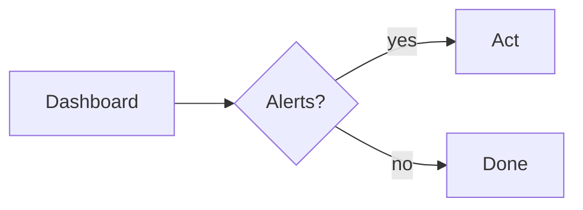

# Operate a node

Daily work is short: read the dashboard, rotate the key monthly, keep the ledger backed up.

The formula for the fee is $f = b + r \cdot n$, where $b$ is the base, $r$ the rate and $n$ the count.

